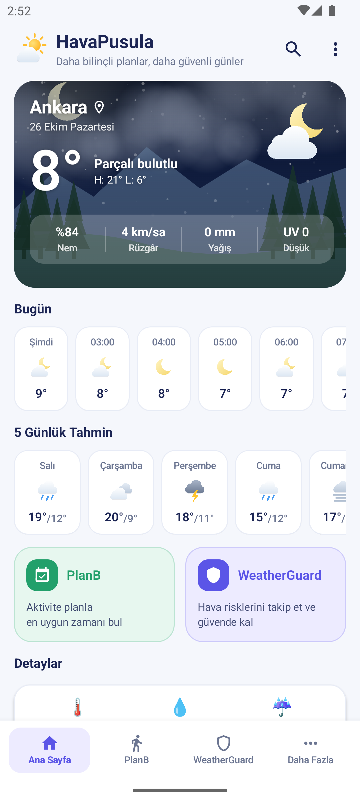
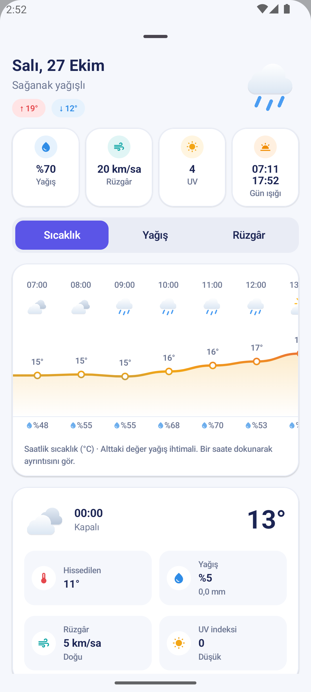
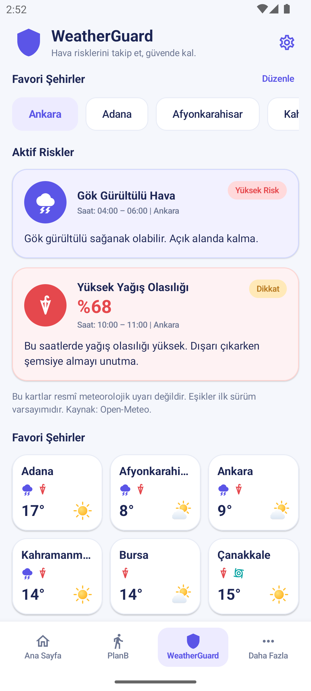
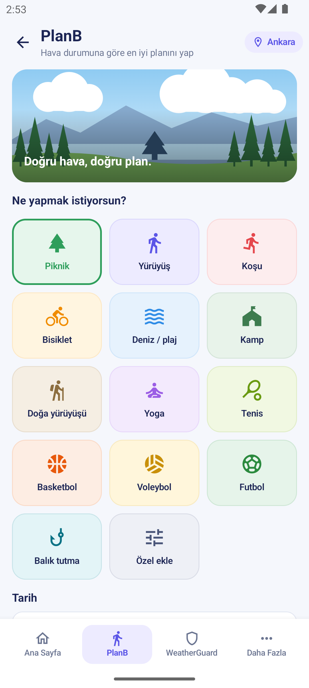
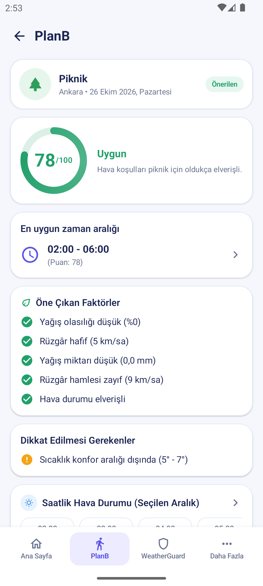
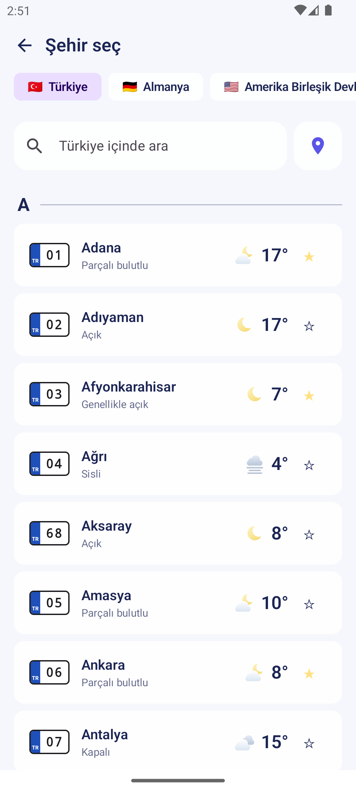
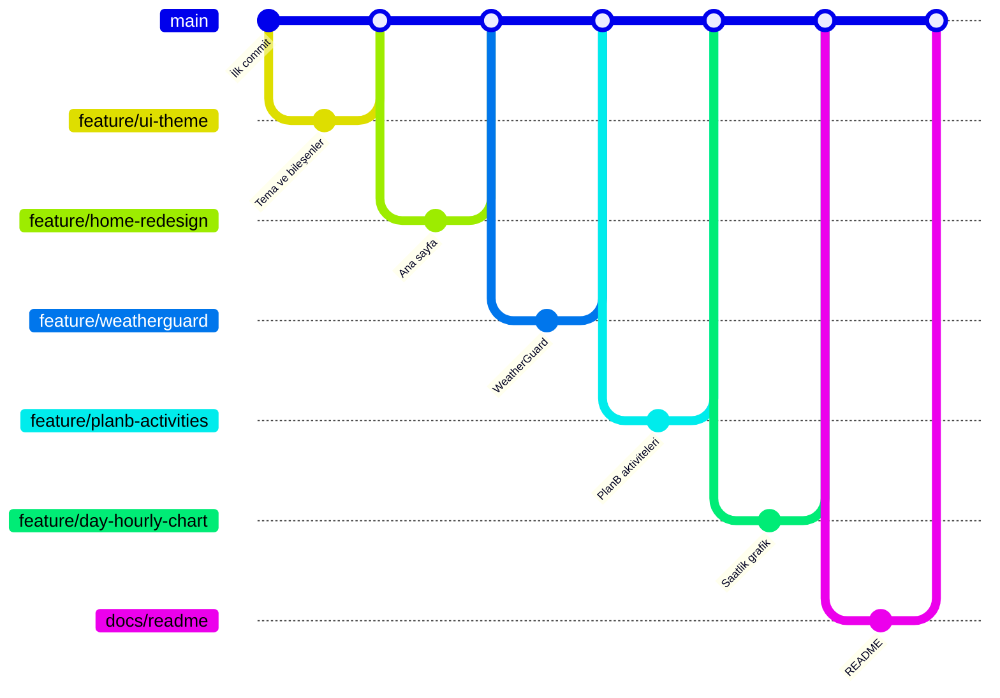

<div align="center">

# 🌤️ HavaPusula

**Daha bilinçli planlar, daha güvenli günler.**

Hava durumunu yalnızca göstermekle kalmayan; aktivitelerin için en uygun zamanı bulan ve hava risklerini senin yerine takip eden bir Android uygulaması.


-3DDC84?logo=android&logoColor=white)


</div>

---

## 📑 İçindekiler

- [Ekran Görüntüleri](#-ekran-görüntüleri)
- [Özellikler](#-özellikler)
- [Kullanılan Teknolojiler](#-kullanılan-teknolojiler)
- [Mimari ve Proje Yapısı](#-mimari-ve-proje-yapısı)
- [Kurulum ve Çalıştırma](#-kurulum-ve-çalıştırma)
- [Testler](#-testler)
- [Veri Kaynakları ve İzinler](#-veri-kaynakları-ve-izinler)
- [Geliştirme Süreci (Branch Yapısı)](#-geliştirme-süreci-branch-yapısı)
- [Sorumluluk Notu](#-sorumluluk-notu)

---

## 📱 Ekran Görüntüleri

| Ana Sayfa | Saatlik Grafik | WeatherGuard |
|:---:|:---:|:---:|
|  |  |  |

| PlanB – Aktivite Seçimi | PlanB – Sonuç | Şehirler |
|:---:|:---:|:---:|
|  |  |  |

---

## ✨ Özellikler

### 🏠 Ana Sayfa
- Bulunduğun konuma ya da seçtiğin şehre göre **anlık hava durumu**: sıcaklık, en yüksek/en düşük, nem, rüzgâr, yağış ve UV indeksi.
- Hava durumuna ve günün saatine göre değişen **animasyonlu gökyüzü sahnesi** (gündüz, gece, gün doğumu/batımı; yağmur, kar, sis, fırtına).
- **Saatlik** ve **5 günlük** tahmin şeritleri.
- Detay kartları: hissedilen sıcaklık, nem, yağış ihtimali, **canlı yağış radarı haritası**, rüzgâr pusulası ve **ay evresi**.

### 📈 Günlük Saatlik Grafik
5 günlük tahminde herhangi bir güne dokunulduğunda açılan detay sayfası:
- Günün özeti: yağış ihtimali, en yüksek rüzgâr, UV ve gün doğumu/batımı saatleri.
- Üç sekmeli, yatay kaydırılabilir grafik:
  - **Sıcaklık** – sıcaklığa göre renk değiştiren yumuşak eğri (soğukta mavi, sıcakta turuncu-kırmızı).
  - **Yağış** – saat saat yağış ihtimali çubukları ve beklenen miktar (mm).
  - **Rüzgâr** – rüzgâr hızı eğrisi ve esiş yönünü gösteren oklar.
- Bir saate dokunarak o saatin hissedilen sıcaklık, yağış, rüzgâr ve UV ayrıntılarını görme.

### 🗓️ PlanB – Aktivite Planlayıcı
Yapmak istediğin aktivite için seçtiğin gün ve saat aralığındaki havayı puanlar.
- **14 aktivite:** Piknik, Yürüyüş, Koşu, Bisiklet, Deniz/Plaj, Kamp, Doğa yürüyüşü, Yoga, Tenis, Basketbol, Voleybol, Futbol, Balık tutma ve **Özel aktivite**.
- Her aktivitenin kendine özgü bir **hava profili** vardır (konforlu sıcaklık aralığı, rüzgâr ve hamle sınırları, yağış toleransı, UV hassasiyeti). Örneğin bisiklette rüzgâr yönü de hesaba katılır.
- Sonuç ekranı:
  - 100 üzerinden **uygunluk puanı** ve seviye: *Çok Uygun · Uygun · Dikkatli Olunmalı · Uygun Değil*
  - Gün içindeki **en uygun zaman aralığı**
  - Olumlu faktörler ve dikkat edilmesi gerekenler
  - Saat saat hava durumu
- Farklı aktiviteleri **karşılaştırma** ve hava uygun değilse **kapalı alan alternatifleri** önerisi.
- **Özel aktivite ekleme:** Listede olmayan bir aktivite (ör. *okçuluk*, *golf*, *yamaç paraşütü*) için ad verip senin için önemli olan metrikleri (**yağış, rüzgâr, sıcaklık, UV**) ve sıcaklık tercihini (serin / ılıman / sıcak) seçebilirsin. Puanlama yalnızca seçtiğin metriklere göre yapılır.

### 🛡️ WeatherGuard – Hava Riski Takibi
Favori şehirlerindeki hava risklerini izler ve seni önceden uyarır.
- **7 risk türü:** Yağış, Kuvvetli rüzgâr, Rüzgâr hamlesi, Aşırı sıcak, Don, Yüksek UV ve Gök gürültülü fırtına.
- Riskler **Dikkat** ve **Yüksek Risk** seviyelerinde, saat aralığı ve şehir bilgisiyle gösterilir.
- Her riskin detay sayfasında risk nedeni, öneriler ve veri kaynağı yer alır.
- **Ayarlar:** risk türlerini aç/kapat, eşik değerlerini kaydırıcılarla kişiselleştir, bildirimleri yönet.
- **WorkManager** ile arka planda yaklaşık **6 saatte bir** kontrol yapılır; yeni bir risk bulunduğunda **bildirim** gönderilir.

### 🌍 Şehirler
- Türkiye'nin 81 ili **plaka numaralarıyla** birlikte listelenir; anlık sıcaklık ve hava durumu doğrudan listede görünür.
- Ülke seçimiyle dünya genelinde şehir arama (Open-Meteo Geocoding).
- Şehirleri **favorilere** ekleme; favoriler WeatherGuard tarafından da takip edilir.

---

## 🧰 Kullanılan Teknolojiler

| Alan | Teknoloji |
|---|---|
| Dil | Kotlin 2.2 |
| Arayüz | Jetpack Compose, Material 3, Material Icons Extended |
| Grafikler ve sahneler | Compose `Canvas` (özel çizim, gradyanlar, `TextMeasurer`) |
| Mimari | MVVM – `ViewModel`, `StateFlow`, `SavedStateHandle` |
| Ağ | Retrofit 3, OkHttp, Gson |
| Arka plan işleri | WorkManager |
| Harita | WebView içinde Leaflet + RainViewer radar katmanı |
| Test | JUnit 4 |
| Derleme | Gradle 9.6 (Kotlin DSL), Android Gradle Plugin 9.4, Version Catalog |

**SDK:** `minSdk 24` (Android 7.0) · `targetSdk 37`

---

## 🏗️ Mimari ve Proje Yapısı

Uygulama, katmanlı bir **MVVM** yapısıyla geliştirildi. İş kuralları (PlanB puanlaması, WeatherGuard risk motoru) arayüzden bağımsız, saf Kotlin sınıfları olarak yazıldı; bu sayede birim testleriyle doğrudan test edilebiliyor.

```
app/src/main/java/com/example/hava/
├── data/                  # Veri katmanı
│   ├── remote/            #   Retrofit API'leri ve DTO'lar (Open-Meteo)
│   ├── repository/        #   Hava, şehir ve konum depoları
│   ├── mapper/            #   API yanıtı → uygulama modeli dönüşümü
│   ├── model/             #   Uygulama modelleri
│   └── local/             #   Tercihler, il/plaka/ülke katalogları, ay evresi hesabı
├── planb/                 # PlanB iş kuralları
│   ├── ActivityType.kt          # Aktiviteler ve özel aktivite tanımı
│   ├── ActivityThresholds.kt    # Aktiviteye özgü hava profilleri
│   ├── ActivityScoringEngine.kt # Saatlik ve aralık puanlaması
│   ├── BestWindowFinder.kt      # En uygun zaman aralığı
│   └── PlanBAlternatives.kt     # Alternatif öneriler
├── guard/                 # WeatherGuard iş kuralları
│   ├── RiskEngine.kt            # Risk tespiti
│   ├── WeatherGuardWorker.kt    # Arka plan kontrolü (WorkManager)
│   └── WeatherNotifications.kt  # Bildirimler
└── ui/                    # Arayüz katmanı (Jetpack Compose)
    ├── screens/           #   weather, planb, guard, city ekranları + ViewModel'ler
    ├── components/        #   Ortak bileşenler, kartlar, saatlik grafik
    ├── background/        #   Animasyonlu gökyüzü sahnesi
    └── theme/             #   Renkler, tipografi, tema
```

---

## 🚀 Kurulum ve Çalıştırma

### Gereksinimler
- Güncel bir **Android Studio** sürümü (Android Gradle Plugin 9.4 desteği olan)
- Android SDK **37**
- İnternet bağlantısı (ilk derlemede bağımlılıklar indirilir)

> Herhangi bir **API anahtarı gerekmez**; kullanılan tüm servisler anahtarsız ve ücretsizdir.

### Adımlar

1. Depoyu klonla:
   ```bash
   git clone https://github.com/Zehracicek/HavaPusula---Kamp-.git
   ```
2. Android Studio'da **File → Open** ile proje klasörünü aç ve Gradle senkronizasyonunun bitmesini bekle.
3. Bir emülatör ya da gerçek cihaz seçip **Run ▶** ile çalıştır.

Komut satırından derlemek istersen:

```bash
# Windows
gradlew.bat assembleDebug

# macOS / Linux
./gradlew assembleDebug
```

Oluşan APK: `app/build/outputs/apk/debug/app-debug.apk`

> **Emülatör ipucu:** Emülatörde konum alınamazsa, emülatörün *Extended Controls → Location* bölümünden bir konum ayarlayabilir ya da uygulamada **⋮ → Şehirler** menüsünden şehir seçebilirsin.

---

## 🧪 Testler

İş kuralları birim testleriyle doğrulanmaktadır:

```bash
./gradlew testDebugUnitTest      # Windows: gradlew.bat testDebugUnitTest
```

| Test sınıfı | Kapsamı |
|---|---|
| `ActivityScoringEngineTest` | Aktivite puanlaması, seviyeler, özel aktivite davranışı |
| `RiskEngineTest` | Risk tespiti ve eşik değerleri |
| `RiskWindowTest` | Riskin geçerli olduğu saat aralığının hesaplanması |
| `RiskNoticeTest` | Aynı riskin tekrar bildirilmemesi ve bildirim kuralları |
| `WeatherRepositoryImplTest` | API yanıtlarının modellere çevrilmesi, önbellek ve hata yönetimi |
| `MoonPhaseTest` | Ay evresi hesabı |
| `CountryCatalogTest` | Ülke kataloğu |
| `ErrorMappingTest` | Hata mesajı eşlemeleri |

---

## 🔌 Veri Kaynakları ve İzinler

**Veri kaynakları**

| Servis | Kullanım |
|---|---|
| [Open-Meteo Forecast API](https://open-meteo.com/) | Anlık, saatlik ve günlük hava tahmini |
| [Open-Meteo Geocoding API](https://open-meteo.com/en/docs/geocoding-api) | Şehir arama |
| [RainViewer](https://www.rainviewer.com/api.html) | Yağış radarı katmanı |
| [Leaflet](https://leafletjs.com/) + Esri harita altlığı | Radar haritası |

**İzinler**

| İzin | Neden |
|---|---|
| `INTERNET` | Hava verilerini almak |
| `ACCESS_COARSE_LOCATION` / `ACCESS_FINE_LOCATION` | Bulunduğun konumun havasını göstermek (isteğe bağlı) |
| `POST_NOTIFICATIONS` | WeatherGuard risk bildirimleri (Android 13+) |

---

## 🌿 Geliştirme Süreci (Branch Yapısı)

Proje, her özelliğin ayrı bir branch'te geliştirilip `main`'e birleştirildiği **feature branch** iş akışıyla yönetildi:

| Branch | İçerik |
|---|---|
| `main` | Kararlı sürüm; tüm özellik branch'lerinin birleştiği dal |
| `feature/ui-theme` | Yeni renk paleti, tipografi ve ortak arayüz bileşenleri |
| `feature/home-redesign` | Ana sayfanın yeni tasarıma göre yenilenmesi |
| `feature/weatherguard` | Risk kartları, risk detayı, ayarlar ve bildirimler |
| `feature/planb-activities` | Yeni aktiviteler ve kullanıcı tanımlı özel aktivite |
| `feature/day-hourly-chart` | Günlük saatlik tahminin grafiksel hale getirilmesi |
| `docs/readme` | Proje dokümantasyonu ve ekran görüntüleri |



---

## ⚠️ Sorumluluk Notu

HavaPusula'daki risk kartları ve aktivite puanları **resmî meteorolojik uyarı değildir**. Eşik değerleri ilk sürüm varsayımlarıdır ve bilgilendirme amaçlıdır. Resmî uyarılar için [Meteoroloji Genel Müdürlüğü](https://www.mgm.gov.tr/)'nü takip edin.

---

<div align="center">

Hava verileri [Open-Meteo](https://open-meteo.com/) tarafından sağlanmaktadır.

</div>
